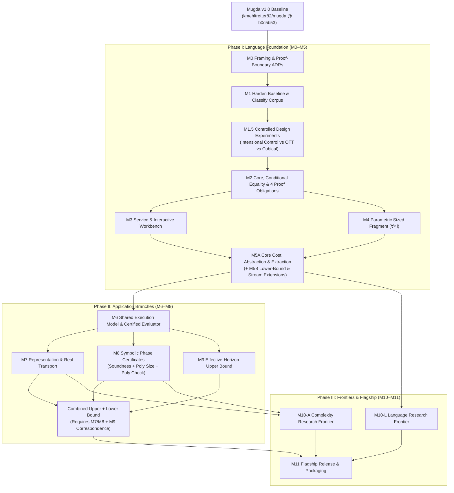

# Mugda2 — Milestone Plan

> [!NOTE]
> **Repository Status:** `mugda2` is currently at the **design and planning stage**. At this stage the repository contains the milestone plan, architectural specifications, and design notes; the Mugda2 checker, core rechecker, and JSON-RPC service described below are planned components building on the verified Mugda v1.0 baseline ([`github.com/kmehltretter82/mugda` @ `b0c5b53`](https://github.com/kmehltretter82/mugda/tree/b0c5b53)).

Synthesized from [idea1.txt](idea1.txt), [idea2.txt](idea2.txt), the foundational literature synthesis, the external design audit, and the Lean 4 baseline in [`kmehltretter82/mugda` @ `b0c5b53`](https://github.com/kmehltretter82/mugda/tree/b0c5b53).

**Identity:** *A dependent programming language and workbench in Lean 4 for constructive algorithms with checked termination, modular abstraction, and computational cost (upper bounds, lower bounds, and cost preservation), with strong support for agents constructing the proofs.*

**Distinctive research question:**
> *Can we build a practical dependent language in which recursive components expose termination and resource contracts, those contracts survive abstraction and representation changes, and agents can synthesize independently checked evidence for them?*

**Core scientific thesis:** Investigate how **parametric sized programming** ($\forall^p i$), **internal parametricity**, and **modular cost reasoning** (*Abstraction Functions as Types* / *Potential Functions as Types* / *Decalf*) work together in a practical, sound language.

---

## Ranking of Foundational Directions

| Direction | Role in Mugda2 |
|---|---|
| **1. Modular reasoning about cost and abstraction** (Grodin–Li–Harper POPL '26; Giralf/Calf '26; Decalf) | **Main distinguishing capability:** components expose mathematical behavior *and* resource guarantees across abstraction boundaries; extended from Giralf's structural recursion to sized recursion and exponential bounds. |
| **2. Parametric sized programming** ($\forall^p i$, Laarakker–Otten–van den Berg '26; Cavallo–Harper) | **Central termination & language-research question:** size uniformity across opaque interfaces (`preprocess : ∀ᵖ i. Certificate i → Certificate i`) without leaking sizes into runtime behavior or carrying large termination proofs. |
| **3. Candidate equality foundations** (evaluated at M1.5): • *Minimal intensional `Id` + explicit simulations* (control) • *Observational Type Theory (OTT)* (Pujet–Tabareau TOPLAS '25) • *Cubical / univalent foundations* | **Selected by evidence at M1.5:** OTT provides pointwise function/quotient equality (with definitional proof irrelevance and provable UIP); intensional/cubical preserve non-trivial identity/path structure (where global K is rejected). |
| **4. Two-level accessibility / recursion translation** (*Definitional Proof Irrelevance Made Accessible*, LICS '26) | **Core architectural mechanism:** convenient unfolding and recursion in the frontend translated into explicit evidence checked by a decidable core. |
| **5. Guarded / clocked recursion** (*Greatest HITs*) | **Secondary track:** relevant when productive stream processors with latency/work bounds become a focus. |
| **6. Directed cost ordering (Decalf)** vs. general simplicial HoTT | **Targeted adoption:** adopt Decalf-style intrinsic cost ordering on types (supporting upper/lower bounds and later randomized pivot rules); defer general synthetic higher category theory. |

### The Four Distinct Quantities Mugda2 Must Separate
Driven by the Avis–Friedmann benchmark, Mugda2 never conflates:
1. **Input size** ($\operatorname{bits}(I_n)$).
2. **Construction cost** of the instance generator producing $I_n$.
3. **Execution cost** of the algorithm on $I_n$ (e.g., $\ge 2^n$ pivots vs. $O(m^2 H \log(2H))$ upper bound).
4. **Certificate size and checking cost** of the symbolic proof explaining that execution.

---

## Baseline: What [`kmehltretter82/mugda` @ `b0c5b53`](https://github.com/kmehltretter82/mugda/tree/b0c5b53) Contributes and What Remains

- **Executable Lean 4 compiler:** `Mugda/Core.lean` (~2.4k lines, Lean `v4.35.0`, zero external dependencies, 0 `sorry`/`partial`/`unsafe`) + `Main.lean` CLI + 22 positive / 17 negative regression suites.
- **Component metatheory in Lean 4:** 34 theorems in `Mugda/Soundness.lean` (e.g., `fixed_pattern_refinement_sound` under explicit ordinal-model hypotheses) and 63 theorems in `Mugda/Metatheory.lean` (e.g., `checkAll_sound` extracting decreasing diagonal witnesses from accepted call matrices, `matchPat_eraseSizes_comm`, and concrete acceptance/rejection tests).
- **Remaining composition & baseline gaps to close in M1–M3:**
  1. **No single end-to-end semantic composition theorem yet:** the baseline proves key algorithmic and model lemmas, but does not yet compose arbitrary successful source checking into a single theorem establishing full language consistency and normalization.
  2. **Foundation-dependent [`examples/k.ma`](https://github.com/kmehltretter82/mugda/blob/b0c5b53/examples/k.ma):** currently in `POS_EXAMPLES`; its expected status in Mugda2 must be indexed by the equality foundation chosen at M1.5.
  3. **Fuel exhaustion (`whnf: out of fuel`) is conflated with type rejection (`Except String`)** — needs a 3-valued result (`accepted | rejected(Diagnostic) | unknown(OutOfFuel)`).
  4. **Non-transactional failure handling in `typeCheckFuns`:** failed obligations append to `st.warnings` and leave `FunSig ... false` in the signature rather than enforcing a transactional boundary for mutual blocks.
  5. **Unclassified `NEG_EXAMPLES`:** mixes genuine soundness exploits (`cody_*`, `loop_wrapped`) with terminating programs that merely lack structural/sized evidence (`rose.ma` breadth-first traversal, `badterm2.ma` division without sizes).
  6. **Dual engines:** `docs/mugda-engine.js` duplicates the checker in JS instead of calling a single Lean checking service.

---

## Dependency Structure: Language First, Parallel Research Branches After M5/M6

Rather than a single rigid chain where a difficult geometric transport proof could block symbolic certificates, the effective-horizon theorem, or language frontier research, the dependency graph branches once the core language (M0–M5) and shared execution model (M6) are in place:

## Timeline Overview

| # | Milestone | Track | Dependencies | Target window |
|---|---|---|---|---|
| M0 | Framing, equality policy, and proof-boundary ADRs | L | Baseline | Nov 2026 (2 wks) |
| M1 | Harden baseline, transactional mutual blocks, classify corpus | L | M0 | Nov – Dec 2026 |
| M1.5 | Controlled foundational experiments (Intensional vs. OTT vs. Cubical) | L | M1 | Jan 2027 (3–4 wks) |
| M2 | Explicit core, equality foundation, and 4-part verification | L | M1.5 | Feb – Mar 2027 |
| M3 | Checking service and interactive workbench | L | M2 | Apr – May 2027 |
| M4 | Parametric sized programming ($\forall^p i$) and core reverification | L | M2 | May – Jul 2027 |
| M5 | Modular cost, abstraction, and extraction (**M5A** mandatory, **M5B** extensions) | L | M3, M4 | Aug – Oct 2027 |
| M6 | Shared execution model and uniqueness-certified evaluator | A | M5A | Nov – Dec 2027 |
| M7 | Cursor-aware simulations and rational $\to$ real transport | A | M6 | Jan – Mar 2028 (parallel) |
| M8 | Symbolic phase certificates with explicit size & check-cost bounds | A | M6 (+ M5B) | Jan – Apr 2028 (parallel) |
| M9 | Effective-horizon upper bound (explicit nonterminal MDP contract) | A | M6 | Feb – May 2028 (parallel) |
| M10 | Frontier selection (`M10-L` language / `M10-A` complexity) | Shared | M5 (for L) or M7/M8/M9 (for A) | Jun – Aug 2028 |
| M11 | Flagship result and reproducible Lake release | Shared | M9.5 / M10 | Sep – Dec 2028 |

---

# Phase I — Language Track

## M0 — Framing, Equality Policy, and Proof-Boundary ADRs
Commit short architecture decision records (ADRs) resolving foundational boundaries up front:

1. **ADR-01: Conditional Equality Policy (resolving the OTT vs. no-K conflict):**
   The status of UIP / Axiom K (`examples/k.ma`) is **indexed by the equality foundation chosen at M1.5**:
   - *Branch A (Intensional `Id` or Cubical path types):* unrestricted K / UIP must **not** be derivable for general identity/path types; `k.ma` on unconstrained `Set` must be **rejected** (and only accepted when restricted to types proved to be h-sets or in a separate strict proposition sort).
   - *Branch B (Observational Type Theory, Pujet–Tabareau TOPLAS '25):* observational equality lives in a definitionally proof-irrelevant sort where UIP is **provable by design**; under this branch, UIP on the observational identity type is **accepted** as an intended theorem of the foundation, not treated as a soundness bug.
   - *Branch C (Two-equality theory combining strict/observational equality with higher paths):* treated as a separate research extension requiring explicit interaction and elimination rules—never assumed implicitly.

2. **ADR-02: The Lean Proof Boundary (distinguishing two senses of "in Lean 4"):**
   Mugda2 is an **object language whose implementation and metatheory are written in Lean 4**, not merely surface syntax macros expanding into unchecked Lean terms. Integration with host Lean 4 mathematical libraries (such as Avis–Friedmann in Phase II) uses three explicit, verified bridges:
   | Connection mechanism | Required formal guarantee |
   |---|---|
   | **1. Native Mugda2 calculus formalized in Lean** | Semantic interpretation $\llbracket - \rrbracket$ or refinement theorem connecting Mugda2 judgments (`HasType`) to Lean propositions. |
   | **2. Translation of a Mugda2 fragment into Lean defs** | Soundness/refinement theorem proving the generated Lean definition preserves the Mugda2 source semantics. |
   | **3. Certificate exchange (primary Phase II bridge)** | Mugda2 extracted programs emit witnesses/certificates $c$; a verified Lean checker theorem `checkCert c = true → Spec` connects acceptance directly to the host Lean theorem. |

3. **ADR-03: The Core Extension & Reverification Rule:**
   > *Every language feature added after M2 (such as $\forall^p i$ in M4 or cost credits in M5) must either (a) elaborate into the already verified M2 core via a semantics-preserving translation, or (b) explicitly extend `Mugda2.Core` and re-establish the required checker, conversion, and semantic soundness theorems for the extended fragment.*

4. **ADR-04: Four Separate Quantitative Judgments:**
   Input/output bit-size, construction cost, execution cost, and certificate size/checking cost are distinct judgments that never silently stand in for one another.

**Exit:** ADRs `01`–`04` committed in `docs/adr/`.

---

## M1 — Harden the Lean 4 Baseline and Classify the Corpus
- Pin [`kmehltretter82/mugda` @ `b0c5b53`](https://github.com/kmehltretter82/mugda/tree/b0c5b53) as the reference oracle.
- **Three-valued checker outcome:** `accepted | rejected(DiagnosticCategory, Span, Msg) | unknown(OutOfFuel)` across checker, CLI, and test runner.
- **Transactional mutual blocks:** replace `FunSig ... false` + string warnings in `typeCheckFuns` with a separate `ProvisionalEnv` during mutual block checking; if any admissibility, completeness, or termination obligation fails, roll back the entire mutual block so no partial/failed declaration can leak into the accepted `Signature`. Add dedicated regression tests for partially failing mutual blocks.
- **Semantic classification of the regression corpus:** replace the flat `POS_EXAMPLES` / `NEG_EXAMPLES` split with a manifest classifying every test by semantic reason and asserting the **exact diagnostic category** on rejection (so a syntax error or fuel exhaustion never counts as passing a soundness rejection test):
  | Category | Examples | Intended policy |
  |---|---|---|
  | `SoundnessCounterexample` | `cody_simplified.ma`, `cody_nowraps.ma`, `loop_wrapped.ma`, `snat_mat_bug.ma`, `stree_mat_bug.ma`, `llet_bug.ma`, `loop.ma`, `loop2.ma`, `loop3.ma`, `badadm.ma`, `badco.ma`, `badlist.ma` | **Must always be rejected** with the specific admissibility, pattern-refinement, positivity, or SCT diagnostic. |
  | `UnsupportedTerminating` | `rose.ma` (BFS on rose trees), `badterm2.ma` (unannotated `div`) | Rejected as written due to missing size/measure evidence; **may become accepted** when rewritten with Mugda2 size/cost contracts. |
  | `IncompleteAnnotation` | `badterm.ma`, `badterm3.ma`, `badterm4.ma` | Reject the unannotated form; pair with an annotated positive counterpart where applicable. |
  | `FoundationDependent` | `k.ma` | Expected status is parameterized by the active equality foundation (ADR-01). |
  | `ResourceExhaustion` | `hang.ma` / budget-limited runs | Must return `unknown(OutOfFuel)`, never `accepted` or semantic `rejected`. |
- **Trust & axiom audit:** CI records `#print axioms` for every theorem and isolates `native_decide`.

**Exit:** all corpus items have manifest classifications and diagnostic-category assertions; failed mutual blocks are transactionally rolled back; fuel exhaustion returns `unknown`.

---

## M1.5 — Controlled Foundational Design Experiments (Gate Before M2)
Run a 3–4 week controlled experiment across fixed benchmarks before selecting the M2 core foundation. Their goal is to **inform the architectural choice with concrete measurements**, not to settle the full metatheory of a new combined calculus.

- **Compared candidates for Experiment A (Modular data-structure & cost swap):**
  1. *Control:* **Minimal intensional `Id` + explicit simulation/abstraction records** in Lean 4.
  2. *Candidate 1:* **Observational Type Theory (OTT)** (Pujet–Tabareau style proof-irrelevant observational equality + quotient/extensionality rules).
  3. *Candidate 2:* **Univalent / cubical abstraction** (Grodin–Li–Harper POPL '26 style, tested via Cubical Agda / prototype).
- **Compared candidates for Experiment B (Sized certificate normalizer across opaque `preprocess : ∀ᵖ i. Certificate i → Certificate i`):**
  1. *Approach A:* Two-level accessibility/recursor translation (LICS '26 style: permissive frontend unfolding translated to a decidable core).
  2. *Approach B:* Native parametric sized-recursion rule in the core.
- **Standardized protocol across all candidates:**
  - Identical benchmark programs, opacity boundaries, and required computation equations.
  - Quantitative measurements: (a) source proof lines/annotations, (b) elaborated core term size, (c) rechecking time/fuel, and (d) metatheoretic surface area added to M2.
- **Explicit fallback rule:** if neither OTT nor Cubical shows a decisive advantage over the Control within the 4-week window, **default to the Control (minimal intensional `Id` + explicit simulations + Approach A translation)** for M2 so language verification is not delayed.

**Exit:** written report in `docs/experiments/m1_5_report.md` recording the measurements and locking in the M2 core specification.

---

## M2 — Explicit Core, Conditional Equality, and Four-Part Verification
For the initial core fragment $F_0$ ($\Pi/\Sigma$, predicative universe hierarchy `Set ℓ`, basic inductives, explicit eliminators / well-typed case trees, explicit relevance, and the M1.5 equality choice), establish **four distinct formal properties** in Lean 4:

1. **Obligation 1 — Checker Soundness:**
   Define declarative judgments `WfEnv Γ` and `HasType Γ t A` as inductive `Prop`s. Prove:
   $$\operatorname{recheck}(\Gamma, t, A) = \mathsf{accepted} \implies \mathsf{WfEnv}(\Gamma) \land \mathsf{HasType}(\Gamma, t, A).$$
2. **Obligation 2 — Semantic Soundness (Logical Consistency & Normalization of $F_0$):**
   Construct a semantic model $\llbracket - \rrbracket$ of $F_0$ in Lean 4 showing that $\mathsf{HasType}\;[]\;t\;A$ implies $t$ normalizes and that the empty type $\bot$ is uninhabited in $[]$.
3. **Obligation 3 — Conversion Soundness & Budgeted Completeness:**
   Distinguish the mathematical conversion relation $t \equiv u$ from the fuel-bounded NbE procedure `conv fuel Γ t u`:
   - *Soundness:* $\operatorname{conv}(\text{fuel}, \Gamma, t, u) = \mathsf{accepted} \implies \Gamma \vdash t \equiv u$.
   - *Budget discipline:* fuel exhaustion returns $\mathsf{unknown}$, never $\mathsf{accepted}$ or $\mathsf{rejected}$.
   - *Completeness on $F_0$:* for well-typed terms in $F_0$, there exists sufficient fuel where `conv` decides $\equiv$.
4. **Obligation 4 — Elaboration Correctness (for $F_0$):**
   State and prove on the core fragment that elaborating a well-scoped surface declaration produces a core term with the translated type and preserves its defining equations.
- Enforce the ADR-01 policy on `examples/k.ma` according to the selected M1.5 branch.

**Exit:** Fragment $F_0$ is specified, implemented in `Mugda2.Core`, and backed by the Lean-checked theorems for Obligations 1–3 (and Obligation 4 on $F_0$ declarations).

---

## M3 — Checking Service and Interactive Workbench
- Lean 4 JSON-RPC service: `checkDocument`, `getGoals`, `getConstraints`, `explainObligation`, `tryCandidate`, `normalizeWithBudget`, `recheckCore`.
- Immutable environment snapshots and branching search states (Pantograph-style) so agents can explore candidate proofs, potentials, and size contracts in parallel.
- **Retire duplicate JS checker:** connect the web UI directly to the Lean 4 service; keep `docs/mugda-engine.js` only as a legacy differential test for v1.0.
- Pluggable workbench panels: **Goal**, **Pattern Refinement**, **Parametric Size & Termination**, **Cost & Potential Contracts**, **Abstraction Boundary**, **Extraction**.

**Exit:** a human and an LLM agent complete the same verification obligation on $F_0$ through the snapshot API.

---

## M4 — Parametric Sized Programming ($\forall^p i$) and Core Reverification
Extend $F_0$ to the sized fragment $F_{\text{size}}$ following **ADR-03** (either via verified translation into $F_0$ or by extending `Mugda2.Core` and re-establishing M2's four obligations):
- Introduce explicit **parametric size quantification** $\forall^p i$ distinct from ordinary $\Pi$, enabling size-preserving abstract interfaces (`preprocess : ∀ᵖ i. Certificate i → Certificate i`) while keeping sizes erasable.
- Port and compose the Pattern-Refinement Invariant (`checkNoccEnv`, `checkNoccDomains`, parameter `nocc`), `ORDER_+` SCT (`checkAll_sound`), and transfinite ordinal semantics (`Soundness.lean`) into an **end-to-end termination/productivity theorem for $F_{\text{size}}$**.
- Cockx–Abel dependent (co)pattern elaboration into explicit case trees with inspectable branch refinements and first-match semantics preservation.
- Copatterns/observations for coinductive streams (finite observation conversion).
- Verify all `SoundnessCounterexample` corpus files are rejected with their expected diagnostic category, and show how `UnsupportedTerminating` examples (`rose.ma`, `badterm2.ma`) can be expressed when supplied with explicit size/measure evidence.

**Exit:** $F_{\text{size}}$ supports modular recursion across opaque $\forall^p i$ interfaces, with M2's checker and semantic soundness obligations established for $F_{\text{size}}$.

---

## M5 — Modular Cost, Abstraction Contracts, and Verified Extraction
Split into a **mandatory core gate (M5A)** and **separately gated extensions (M5B)** so the project can deliver a complete, verified pipeline on schedule.

### M5A — Mandatory Gate: Finite Modular Cost, Abstraction, and Cost-Adequate Extraction
- **Type-level credits, debits, and potentials** (Hofmann / Giralf lineage) for finite inductive and sized programs ($F_{\text{cost}}$), supporting upper-bound compositional verification across abstract interfaces (*Abstraction Functions as Types*).
- **Decorated extraction to `Mugda2.IR`** (Ratiu–Schwichtenberg): erase proofs, `Size` / $\forall^p i$, and ghost cost credits; compile `Mugda2.IR` to native binaries via Lean 4's LCNF/C backend.
- **Two mandatory extraction theorems (value + cost adequacy):**
  1. *Behavioral erasure correctness:*
     $$e \Downarrow_{\text{src}} v \implies \operatorname{erase}(e) \Downarrow_{\text{IR}} \operatorname{erase}(v).$$
  2. *Cost adequacy theorem:*
     $$e \Downarrow_{\text{src}}^{c_{\text{src}}} v \implies \operatorname{erase}(e) \Downarrow_{\text{IR}}^{c_{\text{IR}}} \operatorname{erase}(v) \;\land\; R_{\text{cost}}(c_{\text{src}}, c_{\text{IR}}),$$
     where for upper bounds $c_{\text{IR}} \le c_{\text{src}}$ (erasure never increases abstract step or allocation count).
- **Mandatory benchmark:** a finite-data client program (e.g., verified sorting or priority-queue client) uses an abstract component, its correctness and upper cost bound are checked compositionally against the interface, and extraction satisfies both behavioral and cost adequacy.

### M5B — Gated Extensions (Tracked Separately)
- **Extension M5B-1 (Lower bounds & exponential potentials):** Decalf-style intrinsic cost ordering supporting lower-bound preservation ($c_{\text{IR}} \ge c_{\text{src}}$ or exact pivot-event preservation $c_{\text{IR}} = c_{\text{src}}$) and exponential potential functions (feeds into M8).
- **Extension M5B-2 (Productive streams with separate input-demand and work contracts):**
  Explicitly separate two contracts for stream processors $F$:
  1. *Input-demand (lookahead) contract $L_F(n)$:* producing $n$ output observations inspects at most $L_F(n)$ input observations, composing via $L_{G \circ F}(n) \le L_F(L_G(n))$ (Köpp–Schwichtenberg).
  2. *Per-observation work/latency contract $W_F(n)$:* producing the first $n$ outputs costs at most $W_F(n)$ evaluation steps under a specified memoization/sharing semantics.

**Exit (M5):** M5A is complete and Lean-checked. M5B-1 and M5B-2 have standalone completion gates feeding M8 and M10-L respectively.

---

# Phase II — Application Track (Avis–Friedmann & Pivot Rules)

## M6 — Shared Execution Model and Uniqueness-Certified Evaluator
- Link the Avis–Friedmann Lean 4 package via Lake (`n ≥ 3`, `≥ 2ⁿ` Cunningham pivots, `5(n−1)` constraints, `10(n−1)` variables).
- Define the shared execution and simulation interfaces in Lean 4:
  - **Stateful algorithm with memory:** $s = (\text{basis/policy}, \text{cyclic cursor})$.
  - **Cost-preserving simulation contract** distinguishing pivots, candidate inspections, arithmetic operations, and bit operations.
- **Uniqueness-certified exact evaluator (ADR-02 Bridge 3):**
  An extracted Mugda2 evaluator proposes a policy value vector $v$ (or basis solution). A Lean checker verifies both the linear system **and the uniqueness precondition**:
  $$\operatorname{ invertible }(I - P_\pi) \;\text{(or proved nonterminal transience)}\;\land\; (I - P_\pi)v = r_\pi \implies v = v^\pi,$$
  reusing the reduced nonterminal state-space uniqueness theorem from the Avis–Friedmann development.
- Workbench views for MDP/game graphs, basis/policy, cyclic cursor, and reduced costs.

**Exit:** workbench executes and visualizes legal Cunningham pivots with a uniqueness-certified link to the Lean specification.

---

## M7 — Cursor-Aware Simulations and Rational $\to$ Real Transport *(Parallel with M8, M9)*
- Executable refinement of the noncomputable rational simplex definitions.
- Cost-preserving simulations instantiated across Parity Games $\to$ MDPs $\to$ Rational LPs.
- **Rational $\to$ Real transport:**
  1. Trajectory preservation under ordered-field embedding $\mathbb{Q} \hookrightarrow \mathbb{R}$ (determinants, feasibility, reduced-cost signs, ratio tests, cursor updates).
  2. Real polyhedral geometry statements (vertices, faces, boundedness, adjacency).
- Formalize Maat's direct strategy-improvement $\leftrightarrow$ simplex correspondence using the shared simulation interface.

**Exit:** the prescribed execution and its exact pivot count transport across game, MDP, rational LP, and real LP representations.

---

## M8 — Symbolic Phase Certificates with Explicit Complexity Guarantees *(Parallel with M7, M9)*
Demonstrate the four-quantity separation on the Avis–Friedmann hard family $G(n)$ by establishing **four explicit theorems** for a dedicated, restricted symbolic phase-certificate language (avoiding reliance on arbitrary dependent normalization):

1. **Certificate Soundness:** `checkPhaseCert (G n) (C n) = true` implies the prescribed Cunningham execution from the initial state performs $\ge 2^n$ pivots.
2. **Polynomial Encoded-Size Bound:** there is an explicit polynomial $q(n)$ such that
   $$\operatorname{bits}(G(n)) + \operatorname{bits}(C(n)) \le q(n),$$
   where $\operatorname{bits}(G(n))$ includes all rational numerators/denominators, variable/action ordering, and the initial basis/cursor state.
3. **Polynomial Checking-Cost Bound:** the extracted certificate checker `checkPhaseCert` runs in bit-operation cost bounded by an explicit polynomial $p(n)$ (and hence polynomial in $\operatorname{bits}(G(n)) + \operatorname{bits}(C(n))$).
4. **Uniformity for all $n \ge 3$:** a constructive generator produces $C(n)$ and a Lean induction theorem proves `checkPhaseCert (G n) (C n) = true` for all $n \ge 3$.
- **Bit-encoding corollary:** with $N_n = \operatorname{bits}(G(n)) \le C n^d$ and $T_n \ge 2^n$ ($C, d > 0$), establish $T_n \ge 2^{(N_n / C)^{1/d}}$.

**Exit:** Obligations 1–4 and the bit-encoding corollary are Lean-checked, and the workbench navigates executions by certified phases.

---

## M9 — Effective-Horizon Upper Bound *(Parallel with M7, M8)*
State and prove the cyclic Cunningham upper bound under **explicit nonterminal MDP hypotheses**:
- **Hypotheses:**
  1. Finite nonterminal state set $S$ and finite action sets $A(s)$ with $m = \sum_{s \in S} |A(s)|$ total state-action pairs.
  2. Nonnegative **substochastic** transition matrix $P(s,a,t) \ge 0$ among nonterminal states ($t \in S$).
  3. Drift/transience certificate $w \in \mathbb{R}^S$ and $H \ge 1$ such that for all $s \in S, a \in A(s)$:
     $$1 \le w_s \le H \quad\text{and}\quad \sum_{t \in S} P(s,a,t)\,w_t \le w_s - 1.$$
  4. Exact policy evaluation $v^\pi = (I - P_\pi)^{-1} r_\pi$ and strictly improving single-action switches.
  5. Cyclic schedule where each sweep inspects all $m$ state-action pairs in fixed cyclic order.
- **Target Theorem:**
  $$\operatorname{CunninghamPivots} \le m^2 \cdot \lceil H \ln(2H) \rceil = O\!\left(m^2 H \log(2H)\right).$$
- **Proof components:** (1) fair sweep inspection semantics, (2) Bellman progress $v' \ge \mathcal{T}v$, (3) $w$-weighted norm contraction $q = 1 - 1/H$, (4) action elimination in $O(H \log(2H))$ sweeps.
- **Milestone M9.5 (Combined Lower + Upper Bound Corollary):** *Requires M9 + the M7/M8 correspondence theorem* showing the Avis–Friedmann MDP family satisfies the nonterminal substochastic hypotheses with $m = O(n)$, deducing that any transience certificate for the family must satisfy $H \log(2H) \ge 2^n / \operatorname{poly}(n)$.

**Exit (two explicit paths):**
- *Path A (Proof succeeds):* M9 theorem is Lean-checked, unlocked for the bounded cover-time generalization $O(m B H \log(2H))$ and the M9.5 combined corollary.
- *Path B (Obstruction found):* a formal counterexample or pinpointed lemma failure in Lean 4 documents the exact missing assumption, and the modified statement is recorded before proceeding to M10.

---

# Phase III — Frontiers & Flagship Release

## M10 — Frontier Selection (`M10-L` / `M10-A`)
Because `M10-L` depends only on M5 while `M10-A` depends on M7/M8/M9, language frontier research can start as soon as Phase I finishes:
- **`M10-L` (Language frontier):** internal parametricity for large sizes + higher-order/exponential cost inference, or Decalf-style probabilistic cost bounds.
- **`M10-A` (Complexity frontier):** polynomial-bit LP realizations for Disser–Loho–Maat–Mosis (STACS 2026) generalized families, quantitative $\varepsilon(n)$-robustness of Cunningham lower bounds, or bounded-memory controller lower bounds.

**Exit:** formal candidate statement, literature comparison, and agent-assisted experimental validation.

## M11 — Flagship Result and Packaging
- Complete the selected M10 theorem (and M9.5 synthesis) and package the Mugda2 language, verified core, cost/abstraction library, and Avis–Friedmann workbench as a reproducible Lake release.
- **Flagship end-to-end demonstration:** a user writes an abstract specification with termination and cost contracts; an agent synthesizes the implementation, potential function, and phase certificate; Mugda2 checks all obligations in the verified core and extracts a fast native executable with proved behavioral and cost adequacy.

---

## Summary Matrix: Fragment, Theorems, and Dependencies per Milestone

| Milestone | Formal Fragment / Artifact | Established Theorems | Key Assumptions / Preconditions | Unlocks |
|---|---|---|---|---|
| **M0** | ADRs `01`–`04` | — | — | M1 |
| **M1** | Hardened `Mugda` v1.0 (`ProvisionalEnv`, 3-valued `Outcome`) | Existing 97 theorems + transactional rollback tests | Fuel budget `fuel : Nat` | M1.5 |
| **M1.5** | Prototype benchmarks (Control vs. OTT vs. Cubical; Approach A vs. B) | Benchmark comparison metrics | 4-week timebox; fallback to Control | M2 |
| **M2** | `Mugda2.Core` fragment $F_0$ | (1) `recheck_sound`, (2) $F_0$ consistency/normalization, (3) `conv_sound`, (4) $F_0$ elab correctness | Well-formed core environment | M3, M4 |
| **M3** | JSON-RPC snapshot server + Workbench | Snapshot immutability & state isolation | Rechecker gate on all agent candidates | M5 |
| **M4** | Sized fragment $F_{\text{size}}$ ($\forall^p i$, case trees, copatterns) | M2 Obligations 1–4 extended to $F_{\text{size}}$ + end-to-end termination/productivity | Pattern-Refinement Invariant + `ORDER_+` | M5 |
| **M5A** | Cost & extraction fragment $F_{\text{cost}} \to \text{IR}$ | Behavioral erasure + **Cost adequacy** ($c_{\text{IR}} \le c_{\text{src}}$) + modular abstraction | Finite data, upper-bound potentials | M6, M10-L |
| **M5B** | Lower-bound credits + stream contracts | Input-demand composition $L_{G \circ F} \le L_F \circ L_G$ + work bound $W_F$ | Monotone lookahead; specified sharing | M8, M10-L |
| **M6** | Stateful execution + uniqueness-certified evaluator | $\operatorname{invertible}(I - P_\pi) \land (I - P_\pi)v = r_\pi \implies v = v^\pi$ | Nonterminal transience / invertibility | M7, M8, M9 |
| **M7** | Game $\to$ MDP $\to$ $\mathbb{Q}$-LP $\to$ $\mathbb{R}$-LP simulations | Cost-preserving simulation + $\mathbb{Q} \hookrightarrow \mathbb{R}$ trajectory preservation | Nondegeneracy / ordered-field embedding | M9.5, M10-A |
| **M8** | Restricted phase-certificate language `PhaseCert` | (1) Soundness, (2) $\operatorname{bits} \le q(n)$, (3) check cost $\le p(n)$, (4) $\forall n \ge 3$ uniformity | Explicit encoding of coefficients & cursor | M9.5, M10-A |
| **M9** | Cyclic Cunningham on substochastic MDPs | $\operatorname{Pivots} = O(m^2 H \log(2H))$ (Path A) or formal obstruction (Path B) | Nonterminal substochastic $P$, drift $w_s \le H$ | M9.5, M10-A |
| **M9.5** | Combined lower + upper bound | $H \log(2H) \ge 2^n / \operatorname{poly}(n)$ on Avis–Friedmann MDPs | M7/M8 model correspondence + M9 Path A | M11 |
